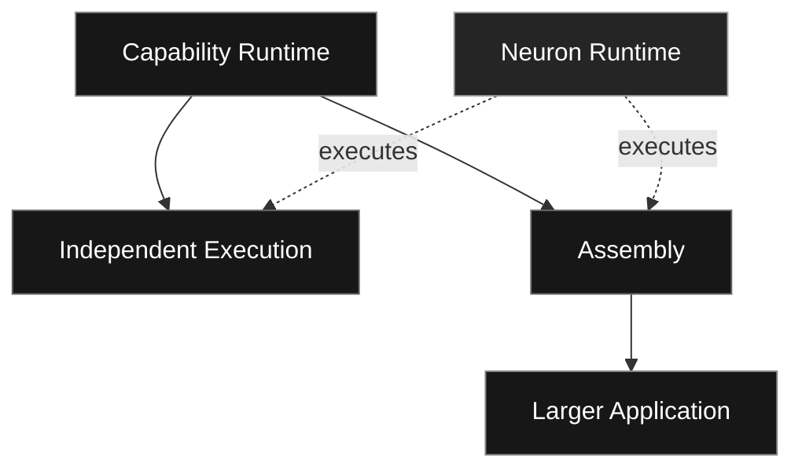

# Neuron

### Build. Connect. Run.

**Neuron is an open-source platform for running software independently and composing it into larger applications.**

It is designed to make software reusable across different programming languages and execution environments.

> Neuron is under active development.

---

## The Idea

Software components should be useful on their own and composable into larger systems. Neuron provides a common execution model for both.

## Core Concepts

- **Capability Runtime** — A packaged unit of functionality that can be executed by Neuron.
- **Assembly** — A composition of capabilities and their relationships, defining how they work together.
- **Neuron Runtime** — The execution layer for Capability Runtimes and Assemblies.

## Designed for Flexibility

Neuron is designed to support components built with different languages and execution environments, without requiring an entire application to use the same technology.

## Explore Neuron

- **Source code:** [neuron-runtime/neuron](https://github.com/neuron-runtime/neuron)
- **Issues:** [Report a problem or follow development](https://github.com/neuron-runtime/neuron/issues)